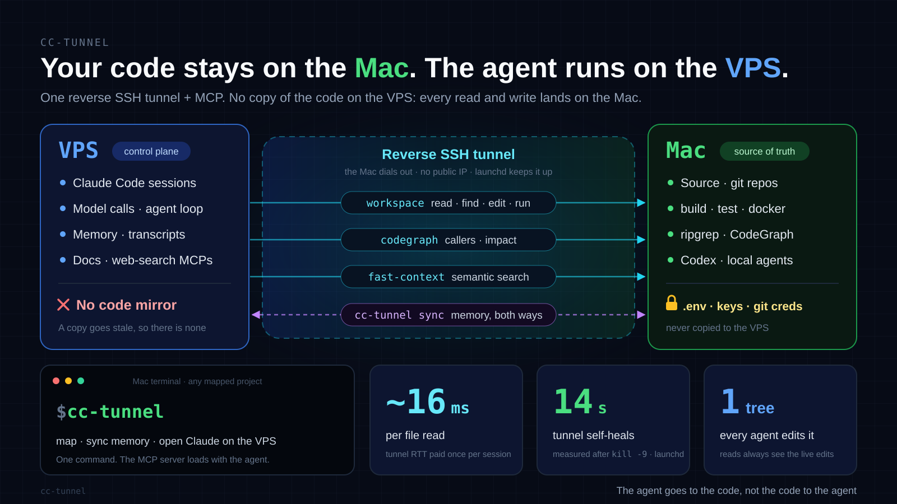

# cc-tunnel

**Your code stays home. Your agent runs anywhere.**

Run Claude Code — or any MCP-capable coding agent — on a remote server while
the source never leaves your own machine. The agent reads, searches, edits,
builds, tests and commits through an MCP server on your machine, over a reverse
SSH tunnel your machine opens. There is no copy of your code on the server, so
there is nothing there to go stale.

[中文说明](README.zh-CN.md)

> [!WARNING]
> **Early preview (v0.1).** Every part is tested on its own: the MCP server,
> the router, memory merge, and the remote installer in a sandboxed home. The
> whole chain has not yet been proven end to end on a fresh server. Expect
> rough edges, and please report them.
>
> **Written largely with AI assistance** and maintained by one person, with no
> professional security audit. It gives a server the ability to run commands
> on your computer, so read [Security](docs/security.md) before you use it.
>
> Not affiliated with Anthropic. "Claude" and "Claude Code" are trademarks of
> Anthropic.



## Why

Running the agent on a server keeps its account, its network path to the model
and its session history in one always-on place you can reach from any machine.
But the code has to stay with you: your git credentials, your `.env` files,
your toolchain, and above all the tree you are actually editing.

The usual answer is to sync a copy of the code to the server. That fails in a
specific way. A copy is stale from the first edit, and stale precisely on the
files being worked on, which is where a wrong answer costs most. On the
author's setup, one such copy sat 56 commits behind while `git` reported it up
to date. cc-tunnel removes the copy instead: **the agent goes to the code, not
the code to the agent.**

## How it works

- **Your machine dials out.** It holds a reverse SSH tunnel open to the server.
  It needs no public IP and no port forwarding, and launchd keeps the tunnel
  alive: measured back up 14 s after a `kill -9`.
- **One MCP server on the remote side, `cc-tunnel-workspace`.** It is a
  ten-line wrapper that goes back through the tunnel and starts
  `cc-tunnel-mcp` on your machine, for whichever project the agent is in.
- **`cc-tunnel-mcp` works on the one real tree.** It reads, finds, patches,
  writes, runs commands and background jobs, and can lease the workspace.
  Paths cannot leave the project root, secret files are refused, and writes can
  be checked against a sha256 and leased with a lock.
- **The server keeps a stub per project:** rules and memory, no source.
  cc-tunnel syncs memory both ways and merges `MEMORY.md` by entry, so neither
  side's additions are lost.
- **`cc-tunnel` is the one command you type.** It finds the project's mapping,
  syncs memory, and opens the agent on the server in the matching stub.

Measured on the author's setup, with a VPS ~160 ms away: tunnel RTT 221 ms,
paid once per session; one `workspace_read` on an established connection
~16 ms; a CodeGraph query 1.34 s; `go build` 25 s and `go test` 16 s, both run
on the local machine through `workspace_exec`. At 16 ms, a tool call costs far
less than the model deciding to make it.

## Requirements

| | Local machine (keeps the code) | Remote host (runs the agent) |
| --- | --- | --- |
| OS | macOS (launchd). Linux works with your own supervisor for the tunnel. | Linux with OpenSSH; 7.8+ to pin the tunnel key to one port |
| Tools | `python3` 3.8+ (`/usr/bin/python3` on macOS), `rsync`, `ripgrep` | `bash`, `ssh`, coreutils; `python3` 3.6+ for the hook step |
| Access | Remote Login (sshd) on, for connections arriving through the tunnel | The agent, e.g. Claude Code, installed for a non-root user |
| Uptime | **Must be on and online while the agent works**: a desktop, a Mac mini or an old laptop that stays home | Always on |

Optional on the local machine:
[`@colbymchenry/codegraph`](https://www.npmjs.com/package/@colbymchenry/codegraph)
and [`fast-context-mcp`](https://www.npmjs.com/package/fast-context-mcp),
reachable from the agent through the same tunnel.

## Quick start

On your machine:

```bash
git clone https://github.com/fengshao1227/cc-tunnel && cd cc-tunnel
./install.sh                                   # tools into ~/.local/bin, config template
ssh-keygen -t ed25519 -f ~/.ssh/cc-tunnel_remote -N ''   # you -> the agent account
ssh-keygen -t ed25519 -f ~/.ssh/cc-tunnel_tunnel -N ''   # you -> the tunnel account
$EDITOR ~/.config/cc-tunnel/config              # host, users, keys, tunnel port
```

On the server, once, as root. Copy the two `.pub` files and
`scripts/vps-bootstrap.sh` up first:

```bash
bash vps-bootstrap.sh --agent-key cc-tunnel_remote.pub --tunnel-key cc-tunnel_tunnel.pub
```

Install Claude Code for the `agent` user, then back on your machine:

```bash
cc-tunnel tunnel start          # launchd keeps it up from now on
cc-tunnel remote-setup          # wrappers, MCP registration, hook, skills on the server
cd ~/code/app
cc-tunnel map                   # this directory -> /home/agent/projects/app
cc-tunnel check                 # ssh, tunnel and the MCP server, end to end
cc-tunnel                       # Claude Code on the server, working on this tree
```

[docs/setup.md](docs/setup.md) covers each step, a second machine, and how to
remove it all.

## Commands

| Command | |
| --- | --- |
| `cc-tunnel [agent args]` | Open the agent on the server in this project, after syncing memory (`--no-sync` skips that). `cc-tunnel -r` passes `-r` for the resume picker. |
| `cc-tunnel map [name]` | Map the current directory to `<remote projects>/<name>`. Refuses a name already taken. |
| `cc-tunnel mappings` | List mappings. |
| `cc-tunnel check` | Mapping, git freshness, ssh, the remote agent, and the workspace MCP server through the tunnel, end to end. |
| `cc-tunnel sync` | Merge memory both ways; push `AGENTS.md`/`CLAUDE.md` to the stub. |
| `cc-tunnel session [n]` | Summarise the last *n* turns of the latest remote session. |
| `cc-tunnel tunnel start\|stop\|restart\|status\|logs` | Manage the launchd tunnel job. |
| `cc-tunnel remote-setup [--with-codegraph] [--with-fast-context] [--yes]` | Install or update the remote side. |

## What's in the box

```text
local/bin/cc-tunnel               the command you type
local/bin/cc-tunnel-mcp           the workspace MCP server (Python, standard library only)
local/bin/cc-tunnel-router        remote directory -> local project root
local/bin/cc-tunnel-link        reverse tunnel, run by launchd
local/bin/cc-tunnel-session       remote transcript -> short summary
local/bin/cc-tunnel-memory-merge  MEMORY.md merged by entry, not by timestamp
remote/                          wrappers, SessionEnd hook, installer, rules block
skills/                          Claude Code skills: workspace, doctor, handoff
scripts/vps-bootstrap.sh         one-time root setup on the server
scripts/check-publishable.sh     no IPs, home paths, keys or tokens in the tree
```

The three **skills** teach the agent how to work this way.
`cc-tunnel-workspace` makes the remote agent use `workspace_*`, never its local
tools, for source. `cc-tunnel-doctor` diagnoses failures by symptom.
`cc-tunnel-handoff` lets a local agent pick up where a remote session stopped.

## Security, in one paragraph

Whoever controls the agent's account on the server can run commands on your
machine as you: `workspace_exec` is a shell, by design. The tunnel and the key
restrictions limit *how* the server reaches you, not *what* the agent can do
once it does. Treat the server as part of your trusted base: patched, single
tenant, and with the agent's account not root. Read
[docs/security.md](docs/security.md) before you use this with code that matters.

## About your Claude account

cc-tunnel runs the official, unmodified Claude Code on your server and does not
touch its traffic to the model. **Every request therefore comes from the
server**, so the server's location is where you use Claude from. Pick a server
in a [supported country or region](https://www.anthropic.com/supported-countries)
with a clean IP, and check the terms of your plan yourself. This describes the
structure; it is not a guarantee about your account.

## Limits

- The local machine must be on. If it sleeps, the agent loses the code
  mid-task, and says so rather than guessing.
- `workspace_exec` is not sandboxed, and the write lease covers only
  `workspace_write` and `workspace_patch`. Commands and your own editor bypass
  it.
- Memory merges by file modification time, so heavy clock skew between the
  machines can pick the wrong side of a same-name file.
- Developed and used with Claude Code against a Linux VPS, from macOS. Other
  agents work, but you register the MCP server yourself
  ([docs/mcp.md](docs/mcp.md)).

## Roadmap

- An end-to-end test on a fresh server, run in CI.
- Ephemeral keys per connection, and a loopback-only sshd started for the
  tunnel instead of macOS Remote Login.
- Permission rules on the server that deny the agent's built-in file tools in
  stub directories, so "use `workspace_*`" is enforced rather than requested.

## Docs

[Architecture](docs/architecture.md) · [Setup](docs/setup.md) ·
[MCP servers](docs/mcp.md) · [Security](docs/security.md) ·
[Troubleshooting](docs/troubleshooting.md)

## License

MIT
