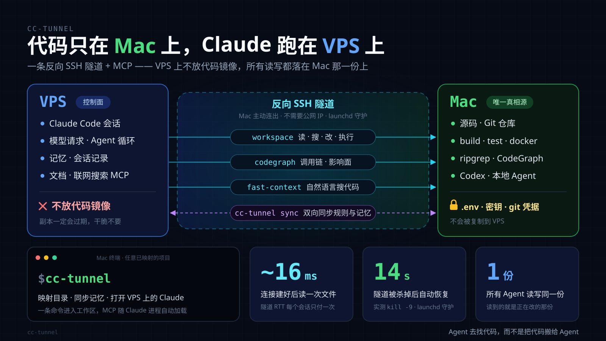

# cc-tunnel

**代码留在家里，Agent 跑在哪都行。**

让 Claude Code（或任何支持 MCP 的编码 Agent）跑在远程服务器上，源码却一步都不离开你自己的机器。Agent 读代码、搜代码、改代码、跑构建、跑测试、提交 git，全都通过你机器上的一个 MCP server 完成，走的是你机器主动打出去的一条反向 SSH 隧道。服务器上没有任何代码副本，所以也就不存在「副本过期」这回事。

[English](README.md)

> [!WARNING]
> **早期预览版（v0.1）。** 各个部件都单独测过：MCP server、路由、记忆合并，远程安装脚本也在隔离的 HOME 里真跑过。但整条链路还没有在一台全新服务器上端到端跑通过。遇到问题欢迎提 issue。
>
> **本项目主要由 AI 辅助编写**，由个人维护，没有经过专业安全审计。它会让一台服务器获得在你电脑上执行命令的能力，使用前请先读[安全说明](docs/security.md)。
>
> 本项目与 Anthropic 没有隶属关系。「Claude」「Claude Code」是 Anthropic 的商标。



## 为什么

Agent 跑在服务器上，账号、到模型的网络、会话记录都集中在一台常开的机器上，从哪台电脑都能接着用。但代码得留在你身边：git 凭据、`.env`、工具链，以及最重要的——你真正在改的那棵代码树。

常见做法是把代码同步一份到服务器。问题在于：副本从你改第一行起就过期了，而且偏偏过期在你正在改的那几个文件上——那正是答错代价最大的地方。作者自己就踩过：一份副本落后 origin 56 个提交，`git` 却报「已是最新」。cc-tunnel 的做法是干脆不要副本：**让 Agent 去找代码，而不是把代码搬给 Agent。**

## 怎么做到的

- **你的机器主动连出去**，和服务器之间保持一条反向 SSH 隧道。不需要公网 IP，也不用做端口映射；launchd 守着它，实测 `kill -9` 之后 14 秒自动恢复。
- **服务器上只注册一个 MCP server：`cc-tunnel-workspace`**。它就是十来行的包装脚本，顺着隧道回到你的机器，按 Agent 当前所在的项目启动 `cc-tunnel-mcp`。
- **`cc-tunnel-mcp` 直接作用在那唯一一棵真实代码树上**：读、搜、打补丁、写、执行命令、后台任务、写锁。路径出不了项目根目录；敏感文件一律拒绝；写入可以带 sha256 校验，也可以加锁。
- **服务器上每个项目只有一个空壳目录**：规则和记忆，没有源码。cc-tunnel 双向同步记忆，并按条目合并 `MEMORY.md`，两边新加的内容都不会丢。
- **你只需要敲一个命令 `cc-tunnel`**：找到当前目录的映射、同步记忆、在服务器上对应的空壳目录里打开 Agent。

作者环境的实测数据（VPS 延迟约 160 ms）：隧道 RTT 221 ms，每个会话只付一次；连接建好后一次 `workspace_read` 约 16 ms；CodeGraph 查询 1.34 s；`go build` 25 s、`go test` 16 s，都是通过 `workspace_exec` 在本机跑的。16 ms 的工具调用开销，远小于模型决定要不要调用它的时间。

## 环境要求

| | 本机（放代码） | 远程（跑 Agent） |
| --- | --- | --- |
| 系统 | macOS（launchd）；Linux 也行，隧道换成你自己的守护方式 | Linux + OpenSSH；7.8+ 才能把隧道密钥锁死在一个端口 |
| 工具 | `python3` 3.8+（macOS 上是 `/usr/bin/python3`）、`rsync`、`ripgrep` | `bash`、`ssh`、coreutils；装 hook 时需要 `python3` 3.6+ |
| 访问 | 打开「远程登录」（sshd），供隧道过来的连接使用 | 用非 root 用户装好 Agent，例如 Claude Code |
| 在线 | **Agent 干活期间必须开机联网**：台式机、Mac mini、或者一台放家里的旧笔记本 | 常开 |

本机可选：[`@colbymchenry/codegraph`](https://www.npmjs.com/package/@colbymchenry/codegraph) 和 [`fast-context-mcp`](https://www.npmjs.com/package/fast-context-mcp)，同样经隧道供 Agent 使用。

## 快速开始

本机：

```bash
git clone https://github.com/fengshao1227/cc-tunnel && cd cc-tunnel
./install.sh                                            # 工具装到 ~/.local/bin，生成配置模板
ssh-keygen -t ed25519 -f ~/.ssh/cc-tunnel_remote -N ''   # 本机 -> Agent 账号
ssh-keygen -t ed25519 -f ~/.ssh/cc-tunnel_tunnel -N ''   # 本机 -> 隧道账号
$EDITOR ~/.config/cc-tunnel/config                       # 主机、用户、密钥、隧道端口
```

服务器上，用 root 执行一次（先把两个 `.pub` 和 `scripts/vps-bootstrap.sh` 传上去）：

```bash
bash vps-bootstrap.sh --agent-key cc-tunnel_remote.pub --tunnel-key cc-tunnel_tunnel.pub
```

给 `agent` 用户装好 Claude Code，再回到本机：

```bash
cc-tunnel tunnel start          # 之后由 launchd 一直守着
cc-tunnel remote-setup          # 在服务器上装包装脚本、注册 MCP、hook、skills
cd ~/code/app
cc-tunnel map                   # 当前目录 -> /home/agent/projects/app
cc-tunnel check                 # ssh、隧道、MCP server 端到端检查
cc-tunnel                       # 在服务器上打开 Claude Code，改的就是这棵代码树
```

每一步的细节、第二台机器、如何彻底卸载，见 [docs/setup.md](docs/setup.md)。

## 命令

| 命令 | 作用 |
| --- | --- |
| `cc-tunnel [agent 参数]` | 同步记忆后，在服务器上本项目对应的目录里打开 Agent（`--no-sync` 跳过同步）。`cc-tunnel -r` 会把 `-r` 传给 Agent，打开恢复会话列表。 |
| `cc-tunnel map [名字]` | 把当前目录映射到 `<远程项目目录>/<名字>`，名字已被占用时拒绝。 |
| `cc-tunnel mappings` | 列出所有映射。 |
| `cc-tunnel check` | 映射、git 新鲜度、ssh、远程 Agent，以及经隧道的 workspace MCP server，端到端检查。 |
| `cc-tunnel sync` | 双向合并记忆；把 `AGENTS.md` / `CLAUDE.md` 推到空壳目录。 |
| `cc-tunnel session [n]` | 总结最近一次远程会话的最后 *n* 轮。 |
| `cc-tunnel tunnel start\|stop\|restart\|status\|logs` | 管理 launchd 隧道任务。 |
| `cc-tunnel remote-setup [--with-codegraph] [--with-fast-context] [--yes]` | 安装或更新远程端。 |

## 包里有什么

```text
local/bin/cc-tunnel               你敲的那个命令
local/bin/cc-tunnel-mcp           workspace MCP server（Python，只用标准库）
local/bin/cc-tunnel-router        远程目录 -> 本机项目根目录
local/bin/cc-tunnel-link        反向隧道，由 launchd 运行
local/bin/cc-tunnel-session       远程会话记录 -> 简短摘要
local/bin/cc-tunnel-memory-merge  按条目（而不是按文件时间）合并 MEMORY.md
remote/                          包装脚本、SessionEnd hook、安装脚本、规则片段
skills/                          Claude Code skills：workspace、doctor、handoff
scripts/vps-bootstrap.sh         服务器上一次性的 root 初始化
scripts/check-publishable.sh     确保仓库里没有 IP、家目录路径、密钥、token
```

三个 **skill** 教 Agent 按这套方式干活：

- `cc-tunnel-workspace`：让远程 Agent 只用 `workspace_*` 碰源码，绝不用它本地的工具。
- `cc-tunnel-doctor`：按症状排查故障。
- `cc-tunnel-handoff`：让本机 Agent 接着远程会话没做完的事继续。

## 安全（一段话版）

谁控制了服务器上的 Agent 账号，谁就能以你的身份在你的机器上执行命令——`workspace_exec` 本来就是一个 shell，这是设计使然。隧道和密钥限制只约束了服务器「怎么」连到你，而不是 Agent 连上之后「能做什么」。把这台服务器当成你信任基础的一部分：打好补丁、不与他人共用、Agent 账号不是 root。在重要代码上使用前，请先读 [docs/security.md](docs/security.md)。

## 账号须知

cc-tunnel 在你的服务器上运行官方、未修改的 Claude Code，不经手也不改写它和模型服务之间的请求。**所有请求都从服务器发出**，所以服务器在哪里，你就算在哪里使用 Claude。请选在 [Anthropic 支持的国家和地区](https://www.anthropic.com/supported-countries)、IP 来源干净的服务器，套餐条款请自行确认。以上只是对结构的说明，不是对账号安全的保证。

## 局限

- 本机必须开着。它一睡眠，Agent 干到一半就碰不到代码了——它会直说，而不是瞎猜。
- `workspace_exec` 没有沙箱；写锁只管 `workspace_write` 和 `workspace_patch`，命令和你自己的编辑器都绕得过去。
- 记忆按文件修改时间合并，两台机器时钟偏差很大时，同名文件可能取错一边。
- 作者是在 macOS 上、配 Linux VPS、用 Claude Code 开发和使用的。其他 Agent 也能用，但 MCP server 需要你自己注册（[docs/mcp.md](docs/mcp.md)）。

## 路线图

- 在 CI 里加一个全新服务器上的端到端测试。
- 改为每次连接临时生成密钥，隧道专用一个只监听回环地址的 sshd，不再依赖 macOS 的「远程登录」。
- 在服务器上用权限规则禁用空壳目录里的自带文件工具，让「只能用 `workspace_*`」从提示变成强制。

## 文档

[架构](docs/architecture.md) · [安装](docs/setup.md) · [MCP 服务](docs/mcp.md) · [安全](docs/security.md) · [排障](docs/troubleshooting.md)

## 许可

MIT
