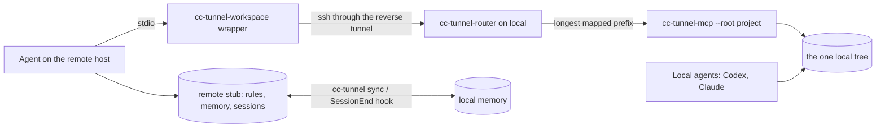

# Architecture

## Source of truth

For a mapped project, the source of truth is the local tree. The remote project
directory is a *stub*: the agent's rules (`AGENTS.md`, `CLAUDE.md`), its
memory, its session records and nothing else. The agent reaches the source
only through the `cc-tunnel-workspace` MCP server.

## Why there is no mirror on the remote host

A copy on the remote host would exist for one reason: the agent's built-in
search and read tools only see their own filesystem. The question is when that
copy is refreshed, and every answer fails.

- **At session start**: stale from the first edit onward, and stale precisely
  on the files being worked on, which is where a wrong answer costs most.
- **Before each search**: that works. An incremental rsync measured 1.25 s with
  nothing changed. But a refresh that has to be remembered will eventually be
  forgotten, and the answer is then confidently wrong with nothing to signal
  it.

Two copies of one repository is also how drift happens. On the author's setup
one checkout fell 56 commits behind. Its https remote could not fetch from a
non-interactive session, so `origin/main` stayed at an old value and
`git rev-list --count HEAD..origin/main` kept answering `0`.

The objection to having no mirror is that it takes the retrieval tools away.
It does not, because they can run where the code is:

| Need | Tool | Reads |
| --- | --- | --- |
| Exact text | `workspace_find` | the canonical tree |
| File names | `workspace_find` with `files_only` | the canonical tree |
| File contents | `workspace_read`, line-numbered, with a hash | the canonical tree |
| Callers, impact, structure | `cc-tunnel-codegraph` (`codegraph_explore` ran in 1.34 s) | the canonical tree |
| Natural-language search | `cc-tunnel-fast-context` | the canonical tree |

Every answer comes from the one tree, which a mirror could never guarantee.

## The workspace server

`cc-tunnel-mcp` is one long-lived stdio process per agent session, over one SSH
channel. The tunnel's 221 ms round trip is paid once, when the session starts.
A `workspace_read` after that took ~16 ms.

It is standard-library Python 3.8+. On macOS a non-interactive ssh session
finds `/usr/bin/python3` (3.9) first, whatever an interactive shell would pick,
so that is the version it is written for, and CI tests on macOS with exactly
that interpreter.

Design choices worth knowing:

- **Results are written for a model's context.** Paths are relative to the
  root. Output has budgets, and says so when it hits one. `workspace_read`
  without a range returns 600 lines, not the whole file.
- **Edits apply to current bytes.** `workspace_patch` replaces a unique
  `old_text` in the file as it is now, so a concurrent change elsewhere in the
  file survives. `expected_sha256` (the full hash or the 16-char prefix that
  reads print) refuses the edit if the file changed at all.
- **Writes keep file mode and line endings**, so a script keeps its executable
  bit.
- **Commands block.** Calls are serial, so long builds use `background: true`
  plus `workspace_job` with `wait_seconds`.
- **A timeout is not a failure.** The reply says the command may still have
  taken effect, because a retried `git push` or migration runs twice.
- **Tool failures are results** with `isError`, which the model sees, not
  protocol errors.

## Concurrency

`workspace_lock` is a lease held with `flock` on a file under
`~/.cache/cc-tunnel/locks/`, keyed by the project root, so nothing is written
into your repository. While one session holds it, `workspace_write` and
`workspace_patch` from every other session are refused. It is released by
`workspace_unlock`, or by the kernel when the holder exits, so a crashed agent
cannot leave a project locked.

It does not cover `workspace_exec`, editors, or local agents writing directly.
For parallel agents, use one `git worktree` each and merge through the
repository.

## Memory and rules

- Memory is `*.md` in the agent's records directory on each side. `cc-tunnel
  sync`, run before every session and by the remote `SessionEnd` hook, merges
  local memory, a shared directory for local agents (`~/.config/ai-context` by
  default) and the remote slot.
- `rsync --update` alone would take the newer `MEMORY.md` whole and silently
  drop entries the other side added. `cc-tunnel-memory-merge` merges the index
  by entry: the newest is kept as written, the older ones contribute what it
  lacks, dead links are removed, and orphaned memories get a generated line.
- Transcripts never move. The filter passes `*.md` only. A transcript holds
  the whole conversation, including anything pasted into it.
- The project's `AGENTS.md` and `CLAUDE.md` are pushed to the stub on every
  sync. Edit them locally; the remote copies are overwritten.

## The tunnel

The local machine runs `ssh -N -R 127.0.0.1:<port>:127.0.0.1:22` to a
forward-only account, under launchd with `KeepAlive`. Its `ServerAlive` bound
of 90 s turns a dead link into an exit, and launchd starts a new one. That
took 14 s after a `kill -9` in testing. The supervisor is idempotent: if any
tunnel on that port is already up, it sleeps and exits, so it never fights a
healthy link.
